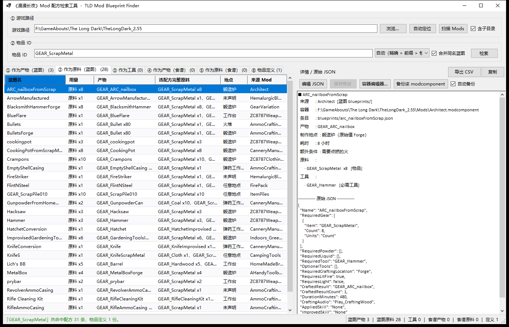
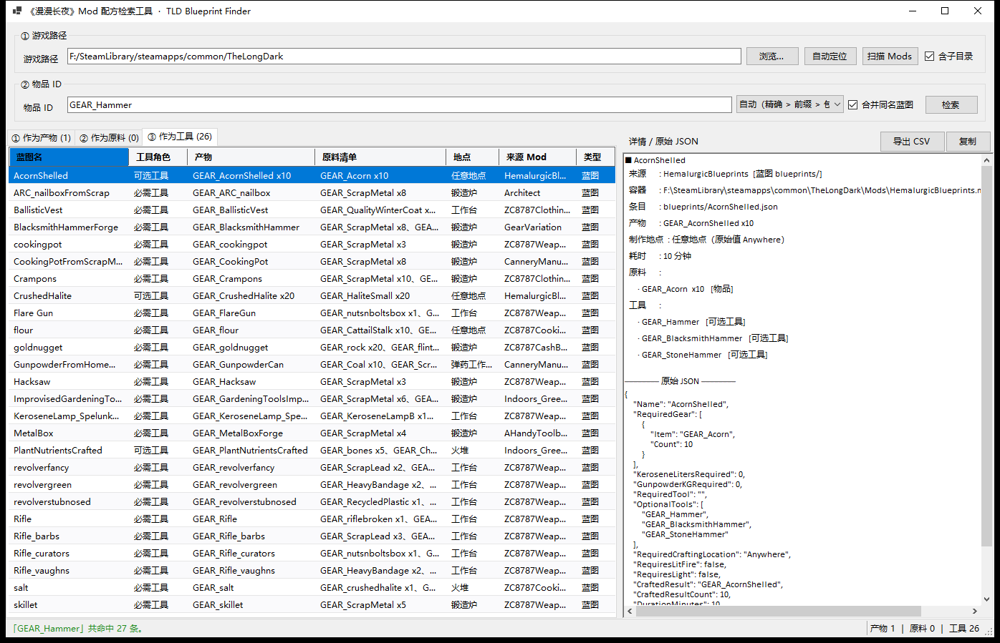
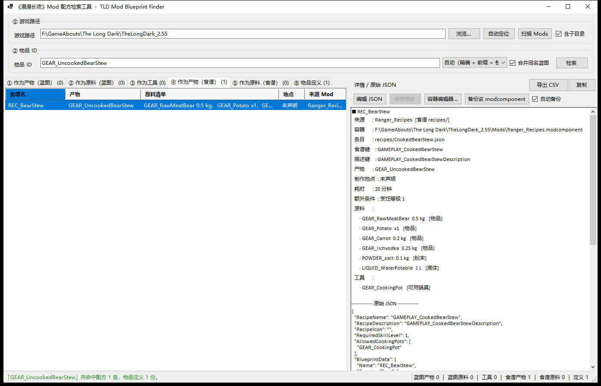
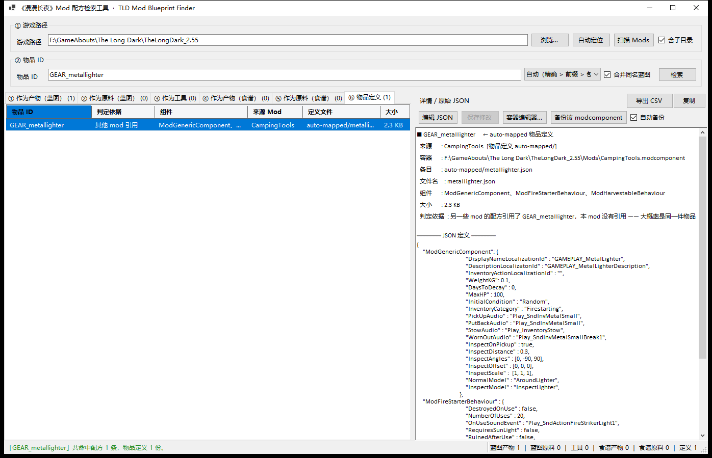
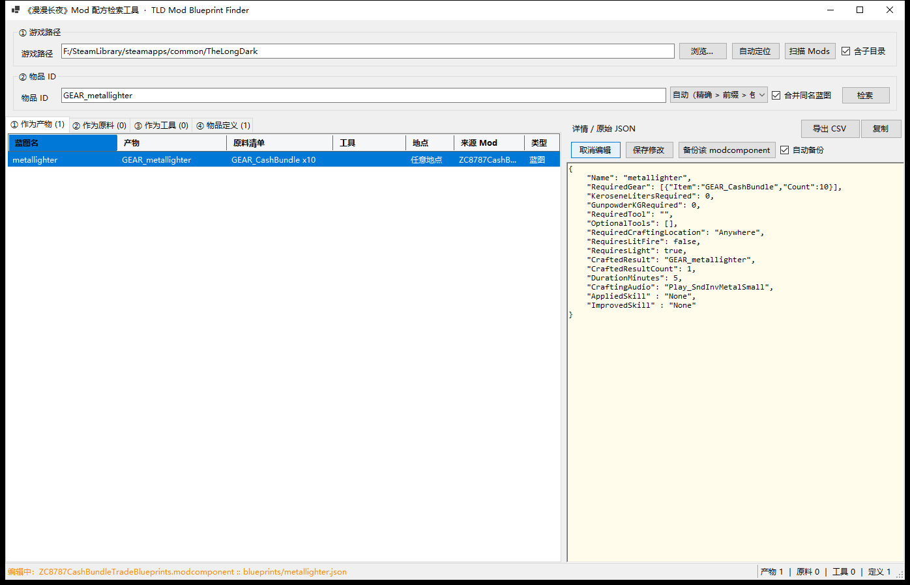
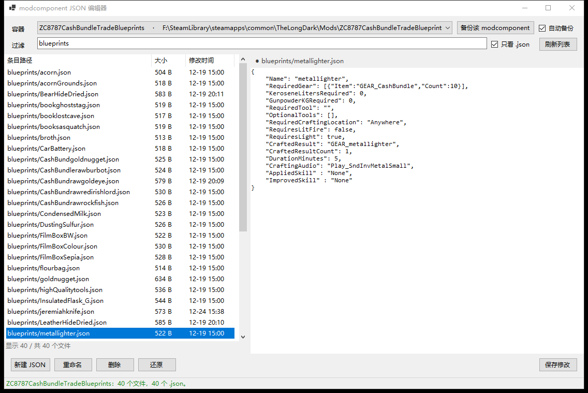

# 漫漫长夜mod配方搜索器 · TLD Mod Blueprint Finder

[English](#english) · [中文](#中文)

---

## English

Reads the `modcomponent` files of a modded The Long Dark install and answers, for one item ID, how it is  
made, what consumes it, and what its own JSON looks like - without unpacking a single zip by hand.

### Features

- Type an item ID and get six separate answer tabs: **as product (blueprint) / as ingredient (blueprint) /  
  as tool / as product (recipe) / as ingredient (recipe) / item definition**. Workbench blueprints and  
  cooking recipes are split because "what tools can this meat make" and "what can this meat cook into" are  
  different questions.
- Tools are listed apart from ingredients: a hammer you have to carry is not a hammer you burn.
- The definition tab pastes the item's own JSON from `auto-mapped/`, so you can copy a working component  
  block into your own mod instead of digging through the container.
- Anything you find can be edited in place and written back, with a backup taken first.
- A partial ID is enough: typing `Acorn` finds `GEAR_AcornShelled`, and widened matches are marked so you can  
  tell them from real ones.
- **The game's own recipes are included**: mod results come first, vanilla ones underneath and read-only. They  
  ship inside the exe, so "what makes this" answers even for an item no mod touches.
- **Night mode**: one tick turns every surface dark, title bar included. The choice is remembered.

### Requirements

- Windows 10 or 11
- The Long Dark **2.55** - the vanilla recipes are built in; mods are optional and read from `Mods`
- Nothing else: the released exe is self-contained and needs no .NET install

### Installation

1. Put `TLD_ModBlueprintFinder.exe` anywhere outside the game folder.
2. Double-click it. The path, the settings file and the backups all stay next to the exe.

### Usage

1. Point the path at the game root (the folder that contains `Mods`) and click `扫描 Mods` -  
   the path is remembered, so later launches scan by themselves.
2. Type an item ID such as `GEAR_Hammer`, `GEAR_ScrapMetal` or `GEAR_metallighter` and press Enter.
3. Pick a row: the right-hand panel shows the full ingredient list, the crafting conditions and the raw JSON.
4. Double-click a row to copy its summary, or use `导出 CSV` to save the current results as a table.

| Match mode | Behaviour                                                                                                                                              |
| ---------- | ------------------------------------------------------------------------------------------------------------------------------------------------------ |
| 自动         | exact first, then prefix, then contains. Partial input still works, but widened rows are shown in orange italics and the tooltip says how they matched |
| 仅精确        | identical IDs only                                                                                                                                     |
| 模糊         | anything containing the text, exact excluded                                                                                                           |

### Item definitions

The last tab is the item's **JSON definition file**, taken from the modcomponent's `auto-mapped/` folder  
(`notes/`, `collectibles/` and `ClothingItems/` hold the same format).

**The "basis" column says how the ID was identified**, because the file itself stores no item ID:

| Basis               | Meaning                                                     |
| ------------------- | ----------------------------------------------------------- |
| same-mod reference  | a recipe of the same mod references this ID - most reliable |
| other mod reference | another mod's recipe references it, usually the same item   |
| file name only      | nothing references it, so the prefix is a guess             |

Case matters: `GEAR_sugara` (a mod item) and `GEAR_SugarA` (vanilla sugar) both reduce to `sugara`. The tool  
prefers an exact-case match, and marks the row "different case" when the two are not the same item.

### Editing and backups

Select any row and the second button strip in the detail panel becomes active:

| Button           | Effect                                                                                        |
| ---------------- | --------------------------------------------------------------------------------------------- |
| 编辑 JSON          | makes this row's JSON editable (recipes and definitions alike); `保存修改` writes it back         |
| 保存修改             | validates the JSON, then writes it into the modcomponent; a parse failure asks before forcing |
| 容器编辑器…           | opens the whole modcomponent to add, rename, delete or edit any JSON inside                   |
| 备份该 modcomponent | copies the current row's modcomponent without changing anything                               |
| 自动备份             | when ticked, every write is preceded by a backup (ticked by default, the state is remembered) |

Backups go to `TLDMBF_modcomponent_backup\` next to the exe as `<mod>.modcomponent-<date_time>`, so repeated  
edits never overwrite each other; restoring means renaming one back to `xxx.modcomponent` and dropping it into  
`Mods`. A write rewrites the whole container and swaps it in, so a failure cannot damage the original - but  
**close the game first**: the file is locked while it runs. Restart afterwards so the modcomponent reloads.

For anything beyond one row, `容器编辑器…` opens the container itself: filter the file list, edit on the right  
(`保存修改` / `Ctrl+S` writes, `还原` reloads), `新建 JSON` inserts a working skeleton for the folder, and  
`重命名` / `删除` ask first. Missing parent folders are added when a new file needs them; textures and fonts  
under `bundle/` are binary and stay read-only.

### Screenshots

<table align="center">  
  <tr>  
    <td align="center"></td>  
    <td align="center"></td>  
  </tr>  
  <tr>  
    <td align="center"><code>GEAR_ScrapMetal</code>: 28 recipes consume it</td>  
    <td align="center"><code>GEAR_Hammer</code>: 26 recipes need it as a tool</td>  
  </tr>  
  <tr>  
    <td align="center"></td>  
    <td align="center"></td>  
  </tr>  
  <tr>  
    <td align="center"><code>GEAR_UncookedBearStew</code>: the recipe tab keeps its dish name, food and pot</td>  
    <td align="center"><code>GEAR_metallighter</code>: its JSON from <code>auto-mapped/</code>, pasted as-is</td>  
  </tr>  
  <tr>  
    <td align="center"></td>  
    <td align="center"></td>  
  </tr>  
  <tr>  
    <td align="center"><code>"编辑 JSON"</code> then <code>"保存修改"</code>; auto-backup leaves a copy first</td>  
    <td align="center">Container editor: create / rename / delete / edit any file inside</td>  
  </tr>  
</table>

### License

Released under the [MIT License](LICENSE).

---

## 中文

输入一个物品 ID，直接读出加 mod 后的《漫漫长夜》里这个物品怎么做、被什么消耗、它自己的 JSON 长什么样，不必再一个个解压 zip。

### 功能

- 输入物品 ID，得到六个互不混淆的分页：**作为产物（蓝图）/ 作为原料（蓝图）/ 作为工具 / 作为产物（食谱）/  
  作为原料（食谱）/ 物品定义**。
- 工具单独一页，不混进原料：要带在身上的锤子，不是要被烧掉的锤子。
- 物品定义页直接贴出 `auto-mapped/` 里这个物品自己的 JSON，改自己的 mod 时照抄即可。
- 查到的东西可以就地改、写回 modcomponent，写之前先备份。
- 只输一部分就能查：`Acorn` 也能找到 `GEAR_AcornShelled`，凑出来的结果会另外标出来，不会跟精确命中混淆。
- **游戏原版配方一并列出**：每一页 mod 的行在前、原版的行在后，原版只读；数据内置在 exe 里，`Mods` 空了也查得到。
- **夜间模式**：勾选后整个界面转深色（含标题栏），选择会被记住，下次启动照旧。

### 前置

- Windows 10 / 11
- 《漫漫长夜》**2.55** —— 原版配方已内置；mod 可选，从 `Mods` 里读取
- 不需要别的：发布版是单文件自包含 exe，不用装 .NET

### 安装

1. 把 `TLD_ModBlueprintFinder.exe` 放到游戏目录以外的任意位置。
2. 双击运行。路径、设置文件、备份都在 exe 旁边。

### 使用

1. 确认顶部路径指向游戏根目录（里面要有 `Mods` 文件夹），点「扫描 Mods」  
   —— 之后每次启动会自动沿用上次的路径并直接扫描，不用重复点
2. 在「物品 ID」里输入，按回车（例如 `GEAR_Hammer`、`GEAR_ScrapMetal`、`GEAR_metallighter`）
3. 点任意一行，右侧显示完整原料清单、制作条件和原始 JSON
4. 双击一行复制它的摘要；「导出 CSV」把当前结果存成表格

| 匹配方式 | 行为                                               |
| ---- | ------------------------------------------------ |
| 自动   | 先精确、再前缀、再包含。拼不全也能查，但补出来的行会用斜体橙字标出，鼠标悬停会说明是怎么匹配上的 |
| 仅精确  | 只认完全相同的 ID                                       |
| 模糊   | ID 里含这段字符就列出                                     |

### 物品定义

最后一个分页是**这个物品的 JSON定义文件**。这些文件放在 modcomponent 的 `auto-mapped/` 文件夹里  
（`notes/`、`collectibles/`、`ClothingItems/` 里也放同格式的定义）。

**「判定依据」列说明这个 ID 是怎么认定的**，因为定义文件里只写文件名、不写物品 ID：

| 判定依据       | 意思                        |
| ---------- | ------------------------- |
| 同 mod 配方引用 | 这个 mod 自己的配方里出现过这个 ID，最可信 |
| 其他 mod 引用  | 别的 mod 的配方引用了它，通常也是同一件物品  |
| 仅文件名       | 没有任何配方引用过，只按文件名对上，前缀不确定   |

大小写：`GEAR_sugara`（某个 mod 加的糖）和 `GEAR_SugarA`（原版糖）去掉前缀后都是 `sugara`。工具优先挑  
大小写完全一致的，不一致时会在「判定依据」里标一句「大小写不同」。

### 修改与备份

选中左侧任意一行，右侧详情栏的第二排按钮就激活了：

| 按钮               | 作用                                         |
| ---------------- | ------------------------------------------ |
| 编辑 JSON          | 把这一条的原始 JSON 变成可编辑状态（配方和物品定义都能改），改完点「保存修改」 |
| 保存修改             | 校验 JSON 后写回 modcomponent；解析不过会先问你要不要硬存     |
| 容器编辑器…           | 进到这个 modcomponent 里面，对全部 JSON 做增删改查        |
| 备份该 modcomponent | 只备份当前行所属的 modcomponent，不做任何修改              |
| 自动备份             | 勾选时每次写入前都先备份一份（默认勾选，状态会记住）                 |

备份放在 exe 同目录的 `TLDMBF_modcomponent_backup\`，文件名是 `<mod名>.modcomponent-<年月日_时分秒>`，改多少次  
都不会互相覆盖；还原时把它改回 `xxx.modcomponent` 丢回 `Mods` 即可。写入是把整个容器重写一遍再替换，中途  
失败原包不会被动过——但还是**建议先关掉游戏**：游戏占着文件时写不进去，改完也要重启游戏才会重新加载。

要改的不止一条时点「容器编辑器…」直接进容器：过滤文件列表、右侧改内容（`保存修改` / `Ctrl+S` 写回，  
「还原」重新读），「新建 JSON」按目录给好骨架，「重命名」「删除」都要二次确认。新建时缺的上级目录会一并  
补进包里；`bundle/` 里的贴图、字体属于二进制，只读显示，不会被当成文本写回去。

### 界面

<table align="center">  
  <tr>  
    <td align="center"></td>  
    <td align="center"></td>  
  </tr>  
  <tr>  
    <td align="center"><code>GEAR_ScrapMetal</code>：28 个配方会消耗它</td>  
    <td align="center"><code>GEAR_Hammer</code>：26 个配方拿它当工具</td>  
  </tr>  
  <tr>  
    <td align="center"></td>  
    <td align="center"></td>  
  </tr>  
  <tr>  
    <td align="center"><code>GEAR_UncookedBearStew</code>：食谱页单独列出这锅炖菜，右侧连着菜名、原料和锅具</td>  
    <td align="center"><code>GEAR_metallighter</code>：右侧直接贴出它在 <code>auto-mapped/</code> 里的 JSON</td>  
  </tr>  
  <tr>  
    <td align="center"></td>  
    <td align="center"></td>  
  </tr>  
  <tr>  
    <td align="center">「编辑 JSON」改完点「保存修改」；勾了自动备份会先留一份</td>  
    <td align="center">容器编辑器：容器里的文件都能新建 / 重命名 / 删除 / 编辑</td>  
  </tr>  
</table>

### 许可证

本项目基于 [MIT License](LICENSE) 发布。
