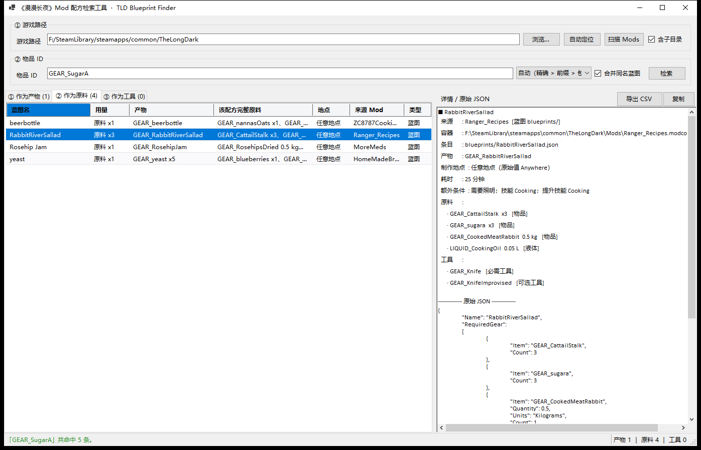
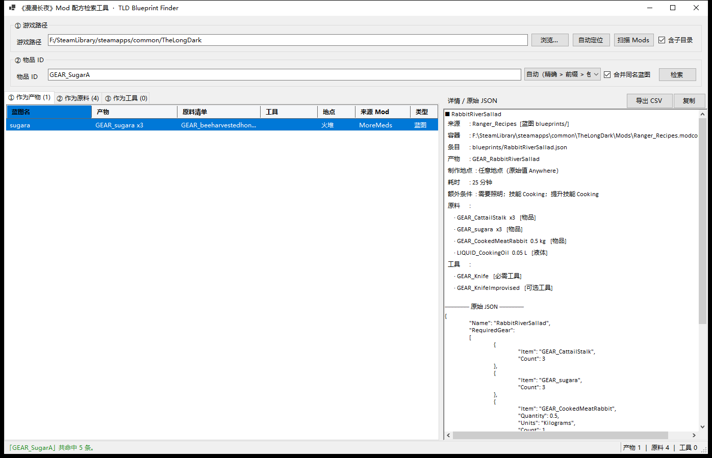
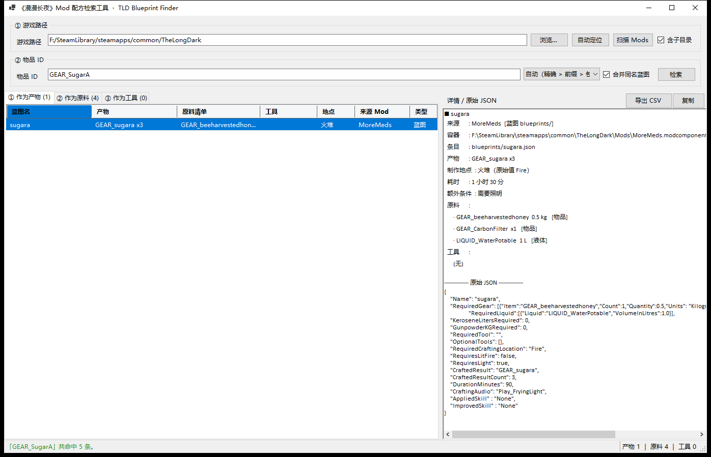
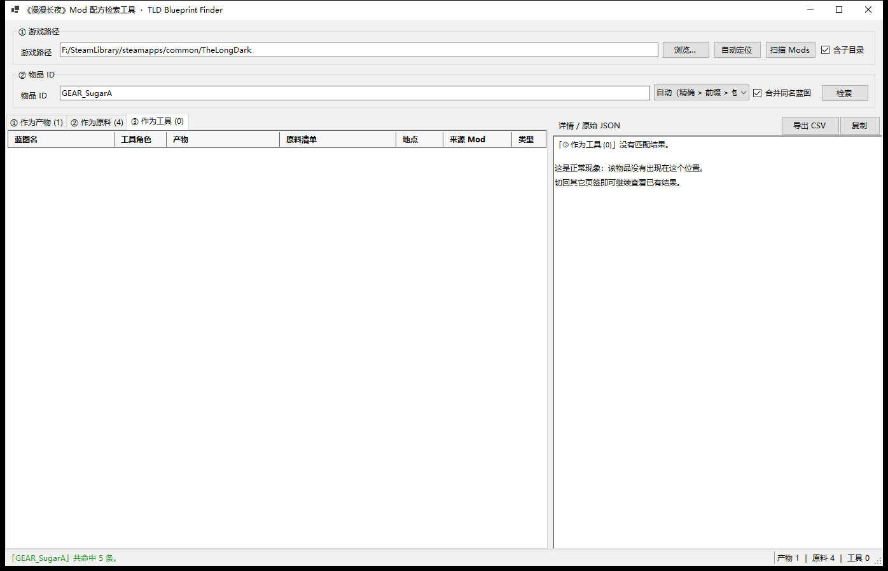

# 缺陷分析报告 · BUG-001：切回【作为产物】后无法显示 sugara 的详情

| 项目 | 内容 |
| --- | --- |
| 缺陷编号 | BUG-001 |
| 报告日期 | 2026-10-25 |
| 涉及模块 | 界面层 · 右侧「详情 / 原始 JSON」面板（当时为三个页签共用） |
| 严重级别 | 中（不崩溃、不损坏数据，但核心操作路径失效且无任何提示） |
| 复现率 | 100%（`GEAR_SugarA` 的【作为产物】只有 1 行且开局即被选中，条件固定成立） |
| 当前状态 | 已复现 → 已定位 → 已修复 → 已回归验证（修复版 v1.0.1；v1.1.0 起程序更名为 `TLD_ModBlueprintFinder.exe`） |

---

## 1. 结论先说

**这不是数据问题，也不是检索问题，而是「详情面板归属状态缺失」导致的界面缺陷。**

界面把「右侧详情该显示哪一行」寄存在一个隐式状态里 —— *上一次点过哪个格子*。
详情面板由三个页签共用，切换页签时没有任何代码去把详情重新同步到「当前页签里选中的那一行」，
点击一个「已经被选中」的行又不会产生任何选中变化事件，于是两条路径同时断掉，详情就卡在别的页签那一行上。

> 本报告记录的是 v1.0.0 的现场。v1.2.0 增加了第四个页签「④ 物品定义」，
> 共用的仍是同一格详情面板与同一套 `IDetailRow` 同步逻辑 —— 新增页签不改变本节结论。

---

## 2. 复现环境

| 项 | 值 |
| --- | --- |
| 程序 | `TLD_ModBlueprintFinder/bin/Release/net8.0-windows/win-x64/publish/TLD_ModBlueprintFinder.exe` |
| 系统 / DPI | Windows 10/11，125% 缩放，窗口 1396×899 |
| 游戏目录 | `F:\SteamLibrary\steamapps\common\TheLongDark` |
| 索引规模 | 46 个 modcomponent / 428 条蓝图 / 489 个物品 ID（139 ms） |
| 复现方式 | 真实鼠标点击（Win32 `SetCursorPos` + `mouse_event`），非代码模拟选中 |

---

## 3. 复现步骤

以下步骤中的坐标均为「窗口绝对坐标」，可原样重放。

| # | 操作 | 观察点 |
| --- | --- | --- |
| 1 | 启动并检索 `GEAR_SugarA` | 状态栏：共命中 5 条（① 1 条 / ② 4 条 / ③ 0 条） |
| 2 | 无需操作 | 默认停在【作为产物】，唯一一行 `sugara` 已选中，右侧显示 sugara 详情 |
| 3 | 点【作为原料】页签（414,262） | 列表出现 4 行（beerbottle / RabbitRiverSallad / Rosehip Jam / yeast），详情自动变成 beerbottle |
| 4 | 点 `RabbitRiverSallad` 行（300,339） | 详情切换为 RabbitRiverSallad ✔ |
| 5 | 点回【作为产物】页签（319,262） | 列表只剩 `sugara` 一行，**仍高亮选中**；右侧详情**依旧是 RabbitRiverSallad** ✘ |
| 6 | 点 `sugara` 这一行（300,315） | **详情没有任何变化**，仍是 RabbitRiverSallad ✘ |

第 1–2 步：初始状态（右侧为 sugara）


第 4 步：详情已切到 RabbitRiverSallad



第 5 步：页签已切回【作为产物】，左侧高亮的是 sugara，右侧却是 RabbitRiverSallad



第 6 步：再点 sugara 那一行，截图与第 5 步**逐字节相同**（`bug-3` 与 `bug-4` 的 MD5 一致），证明点击完全没有效果


---

## 4. 预期 / 实际对照

| 环节 | 预期行为 | 实际行为 | 结论 |
| --- | --- | --- | --- |
| 检索后初始展示 | 显示 `sugara` 详情 | 显示 `sugara` 详情 | ✔ |
| 切到【作为原料】并点其他蓝图 | 详情跟随所点行 | 跟随 | ✔ |
| 切回【作为产物】 | 详情应显示该页签中已选中的那行（sugara） | 仍显示上一页签的 RabbitRiverSallad | ✘ |
| 点击【作为产物】的 sugara 行 | 详情切回 sugara | 无任何变化 | ✘（用户报告的现象） |
| 操作过程中的错误提示 | —— | 无提示、无报错、无日志 | 缺陷被完全静默 |

> 关键点：用户看到的「点不动」有两层，缺一不可地解释了这个体验 ——
> **先看错了**（切页签时详情就没跟上），**再点也救不回来**（点已选中行不触发事件）。

---

## 5. 复现条件提炼

触发需要同时满足：

1. 目标物品在**两个不同页签**里都有结果，且用户先访问了非默认页签 —— 对 `GEAR_SugarA`，是「1 个产物 + 4 个原料」。
2. 回到【作为产物】时，目标行**仍处于选中状态**（未被清除）。
3. 点击的是**同一行**（本项目里 `SelectFirstRow` 在检索完成后就已把第 0 行设为 CurrentRow）。

第 3 条是这个缺陷「看起来像坏了」的核心：如果用户点的是同一行里的**另一列**，
`CurrentCell` 变化会顺带触发选中事件，详情反而会刷新 —— 因而表现为「有时能切、有时不能切」的间歇性错觉。
实测：点第 0 列（蓝图名）无效，点第 3 列（原料清单）有效。

---

## 6. 根因分析

### 6.1 事件层（直接原因）：只监听 `SelectionChanged`，覆盖不到「点击已选中行」

原实现中，三张表格的详情刷新全部挂在 `SelectionChanged` 上：

```csharp
// 修复前 Ui/MainForm.Ui.cs
grid.SelectionChanged += onSelectionChanged;   // 仅此一处
```

`DataGridView.SelectionChanged` 的语义是**选中集合发生变化**时才触发。当被点击的行已经是选中行、
且点中的是当前单元格时，选中集合没有任何变化 → 事件不触发 → 详情不刷新。

**探针证据**（临时在三个网格上加日志，复现同一路径后抓取）：

```
13:47:55.966  ShowDetail(gridIngredient)  ← 来自 _gridIngredient_SelectionChanged
13:47:55.980  SelectionChanged row=1
13:47:56.025  CellClick row=1 col=0       ← 正常：选中变化 + 点击 都到齐

13:47:57.559  CellClick row=0 col=0       ← 用户点 sugara：只有点击，没有 SelectionChanged
```

最后一行是缺陷的现场：`CellClick` 到了，但没有任何监听者；`SelectionChanged` 一次都没来。

### 6.2 状态层（根本原因）：共享控件缺少「归属页签」这一维状态

详情框 `_txtDetail` 是三个页签共用的一格，但代码里没有任何地方记录
「它现在显示的是哪个页签里哪一行」。展示逻辑只回答「刚点的是哪一行」，不回答「当前该显示哪一行」。

于是第 5 步切回【作为产物】时，代码没有任何机会去纠正 —— `SelectedIndexChanged` 上没有处理器。
这一步即使不点任何东西，界面已经自相矛盾了（左侧选中 sugara，右侧写着 RabbitRiverSallad）。

### 6.3 数据标识层（已核查，不是本缺陷原因）

按诊断要求逐项排除了「同一蓝图在不同视角下标识不一致」的可能：

- 每个表格行绑定的是独立的 `SearchRow` 实例，携带自己的 `BlueprintRecord`，
  详情文本由 `row.BuildDetailText()` 就地生成，不依赖任何全局「当前蓝图」变量。
- 「作为产物」与「作为原料」出现的 `GEAR_sugara` 分属两条不同记录（`sugara` 与 `RabbitRiverSallad`），
  索引里 `CraftedResult` / `RequiredGear[].Item` 分别建表，未混用。
- 结论：**不存在标识错配**。移除事件缺失后，同一行点击必然得到同一份文本 —— 修复后的回归结果也印证了这一点。

---

## 7. 修复方案（已实施）

三处改动，分别堵住事件的漏、补上状态的缺、并给空页签一个明确交代。

### 7.1 补一个「点击」事件（`Ui/MainForm.Ui.cs:348`）

```csharp
// 两个事件都要绑，缺一不可：
//   SelectionChanged —— 键盘上下键、程序化选中（此时选中项真的变了）
//   CellClick        —— 鼠标点击已被选中的行（选中项没变，不会触发 SelectionChanged）
grid.SelectionChanged += onSelectionChanged;
grid.CellClick += (_, e) => { if (e.RowIndex >= 0) ShowDetail(grid); };
```

`CellClick` 在鼠标抬起时触发，与「选中是否变化」无关，因此恰好补上这块盲区；列头（`RowIndex = -1`）被过滤。

### 7.2 页签切换时重新同步详情（`Ui/MainForm.cs:611`，绑定在 `Ui/MainForm.Ui.cs:202`）

```csharp
private void OnTabChanged(object? sender, EventArgs e)
{
    var grid = ActiveGrid();          // 当前页签对应的表格

    if (grid.Rows.Count == 0)
    {
        if (_outcome is { TotalHits: > 0 })
            SetDetailText($"「{_tabs.SelectedTab?.Text}」没有匹配结果。\n\n" +
                          "这是正常现象：该物品没有出现在这个位置。\n" +
                          "切回其它页签即可继续查看已有结果。");
        return;
    }

    if (grid.CurrentRow is null)      // 页签首次显示时可能还没有当前行
    {
        grid.ClearSelection();
        grid.Rows[0].Selected = true;
        grid.CurrentCell = grid.Rows[0].Cells[0];
    }

    ShowDetail(grid);
}
```

顺带解决一个同源问题：切到**空页签**（例如 `GEAR_SugarA` 的【作为工具】）时，
原先会继续显示别的页签的蓝图，容易被误读成「这一页的内容」。现在明确写成「没有匹配结果」。

### 7.3 渲染去重（`Ui/MainForm.cs:574`）

```csharp
var text = row.BuildDetailText();
if (_txtDetail.Text == text) return;   // 已经在显示这一条，不重复渲染
```

选中变化与鼠标点击会先后触发一次渲染，不去重的话详情框的滚动位置会被连续重置
（检索完成时 `SelectFirstRow` 就曾连续渲染 3 次），读长 JSON 时体验很差。去重同时保证了
「重复点同一行」不会把你已经滚到的位置弹回顶部 —— 这才是点击无反应本该有的样子。

### 7.4 附带的健壮性处理

- `ShowDetail` 在 `CurrentRow` 为空时回退到第一条选中行（兼容 Ctrl 多选与程序化选中）。
- 三个网格补上 `Name`（`gridProduct` / `gridIngredient` / `gridTool`），此后任何堆栈与日志都自带上下文。

---

## 8. 回归验证

修复后在同一台机器、同一份数据上重放，并补充边界场景。

| # | 用例 | 预期 | 实测 | 结果 |
| --- | --- | --- | --- | --- |
| R1 | `GEAR_SugarA` → 进【作为原料】点 `RabbitRiverSallad` | 详情 = RabbitRiverSallad | 一致 | 通过 |
| R2 | 切回【作为产物】（不点任何行） | 详情 = sugara | 一致（见下图） | 通过 |
| R3 | 再点 sugara 行 | 详情保持 sugara，无变化 | 截图与 R2 逐字节一致 | 通过（幂等） |
| R4 | 在【作为产物】点同一行**另一列** | 详情 = sugara | 一致 | 通过 |
| R5 | 切到空的【作为工具】 | 明确提示「没有匹配结果」 | 一致 | 通过 |
| R6 | 从【作为工具】切回【作为原料】 | 详情 = 该页签选中行（beerbottle） | 一致 | 通过 |
| R7 | 界面内重新输入 `GEAR_Cloth` 回车 | 自动切到【作为原料】，详情 = 首行 | 一致 | 通过 |
| R8 | `GEAR_Cloth` 点空的【作为产物】 | 显示「没有匹配结果」提示 | 一致 | 通过 |
| R9 | 在 42 行列表里按 ↓↓ | 详情跟随到第 3 行 | 一致 | 通过 |
| R10 | Ctrl+点击第 4 行 | 详情 = 该行（yeast） | 一致 | 通过 |
| R11 | CLI 回归 `GEAR_SugarA / ScrapMetal / Hammer / UncookedBroth` | 1-4-0 / 3-28-0 / 1-0-26 / 1-0-0 | 完全一致 | 通过 |

R2 修复后（左侧选中 sugara，右侧详情同步回到 sugara；与缺陷图对比即可看出差异）：



R5 空页签的显式提示：



> 说明：`bug-1-initial.png` 与 `fix-1-detail-restored.png` 逐字节相同 —— 这正是修复的目标：
> 回到【作为产物】时界面应当与刚检索出来时一模一样。

---

## 9. 影响范围评估

同一根因可能波及的操作，已逐条确认：

| 场景 | 是否受影响 | 说明 |
| --- | --- | --- |
| 点已选中行的第 0 列 | 受影响 | 本次报告的缺陷；已修 |
| 点已选中行的其它列 | 未受影响 | `CurrentCell` 变化会连带触发选中事件；已修后仍正常 |
| 页签来回切换（不点击） | 受影响 | 详情停留在旧页签的行；已修（7.2） |
| 键盘 ↑↓ 切换行 | 未受影响 | 选中确实变化，事件正常；已回归 R9 |
| Ctrl 多选 | 未受影响 | `CurrentRow` 跟随点击格；已回归 R10 |
| 重新检索后 | 未受影响 | `SelectFirstRow` 重新设定当前行；已回归 R7 |
| 导出 CSV / 复制详情 | 不受影响 | 不读取「当前选中」状态，读取的是 `row` 与 `_txtDetail.Text` |

界面层之外的解析与检索（`Parsing/`、`Indexing/`）没有改动，CLI 结果与修复前完全一致（R11）。

---

## 10. 待验证推测

以下两条**未在本轮取得证据**，不应当作结论使用：

1. *推测*：若某个 mod 的 `CraftedResult` 与 `RequiredGear[].Item` 在同一 modcomponent 内互相指向同一 ID，
   用户在两个页签里会看到「同名蓝图」分组，此时页签切换后详情是否仍可能混淆 —— 需要构造这样的 mod 才能验证。
   现有语料里没有命中该形态的样本。
2. *推测*：当结果集极大（行数上千）时，`_txtDetail.Text == text` 的整串比较成本会随文本增长而上升。
   当前最大详情约 6 KB、428 条记录规模下实测无感；若将来索引扩大到万级，建议改用行引用比较。

---

## 11. 交付物

- 源码修复：`TLD_ModBlueprintFinder/Ui/MainForm.cs`（574–645）、`TLD_ModBlueprintFinder/Ui/MainForm.Ui.cs`（202、347–348）
- 已更新二进制：`TLD_ModBlueprintFinder/bin/Release/net8.0-windows/win-x64/publish/TLD_ModBlueprintFinder.exe`（现为 v1.1.0，约 260 KB）
- 复现与验证截图：`docs/img/`
- 复现脚本（可重放）：`D:\code\WorkBuddy_WorkSpace\The_Long_Dark\analysis\repro_click.py`
